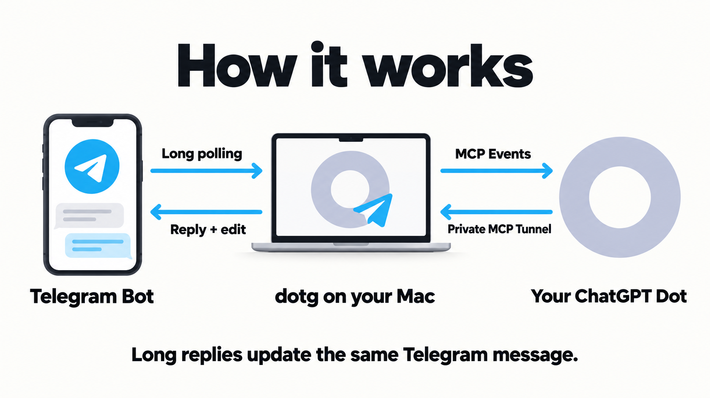

# dotg

<p align="center">
  
</p>

Talk to your existing ChatGPT Dot from Telegram. Ask a question, send an idea, or pick up a conversation with your personal assistant through your own Bot. Longer answers grow in the same message, keeping your chat easy to follow.

## Install with your Agent

```text
Read https://github.com/vingeraycn/dotg/blob/main/docs/desktop-install.md
and install dotg on this Mac for my Telegram Bot and existing ChatGPT Dot.
First explain which actions require me, then complete the setup using
local tools and Computer Use. Reuse existing resources, protect secrets,
preserve rollback, and verify a real reply and in-place message updates.
```

Paste this into Codex or ChatGPT Work with access to your Mac. Your Agent handles setup and explains any login or permission steps that need you. See the [desktop guide](docs/desktop-install.md) for requirements. The repository is currently private, so your Agent needs read access.

## What you get

- **Your existing Dot, in Telegram.** Reach your personal assistant through your own Bot.
- **A clearer wait.** A temporary queued draft shows that your message arrived; Thinking/typing appears when Dot reads it.
- **Replies that stay together.** Short answers arrive in one message; longer answers update that message as more content is ready.
- **A private chat you control.** Only explicitly approved private chats can use the bridge.

## How it works



1. **Send a message in Telegram.** dotg on your Mac retrieves messages from your Bot and checks the private-chat allowlist.
2. **Your Dot receives an event.** dotg forwards the message through signed MCP Events. Dot reads it and prepares a reply.
3. **The reply comes back to your chat.** Dot calls dotg's tools through a private MCP Tunnel. dotg sends the reply through Telegram's Bot API and edits the same message for longer answers.

No public Telegram webhook, domain or inbound port is needed for this Mac route. Messages are processed by Telegram and ChatGPT, with private state stored on your Mac; see [data handling](docs/privacy.md).

The Mac must remain available. Dot's scheduling can add variable delay, and message updates are cumulative chunks rather than token-by-token streaming. Automatic login/reboot startup is not yet implemented.

The private Mac route has passed live discovery, Events subscription, short reply, cumulative edit, successful retry, and backend restart checks. This is a low-volume, single-owner service. Unattended boot/login recovery, every account configuration, and predictable response latency are not established.

## Guides

| Goal | Guide |
| --- | --- |
| Start from Codex or ChatGPT desktop | [Desktop Agent installation](docs/desktop-install.md) |
| Install or resume with an Agent | [INSTALL.md](INSTALL.md) |
| Connect the private Tunnel | [TUNNEL.md](TUNNEL.md) |
| Configure the Dot event handler | [Dot task instructions](docs/dot-task.md) |
| Inspect, restart, recover, or roll back | [OPERATIONS.md](OPERATIONS.md) |
| Understand security and reporting | [SECURITY.md](SECURITY.md) |
| Understand message storage and privacy | [Data handling](docs/privacy.md) |
| Contribute and run checks | [CONTRIBUTING.md](CONTRIBUTING.md) |
| Prepare the public release | [Release readiness](docs/release-readiness.md) |
| Understand design and provenance | [ARCHITECTURE.md](ARCHITECTURE.md), [SOURCE_STATUS.md](SOURCE_STATUS.md) |

The [portable plugin template](PLUGIN.md) is for a separately hosted HTTPS backend. Its placeholder is deliberately not installable and is not a Tunnel package. The [Sites adapter](sites/README.md) is source-only with production callback delivery disabled; it is not the supported onboarding route.
